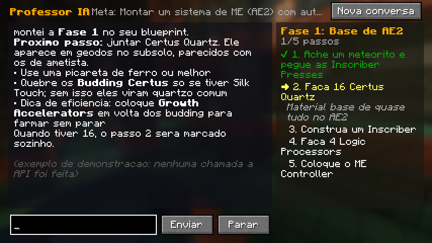

# Professor IA — um professor com Claude dentro do Minecraft

Mod para **Minecraft Java 1.21.1 + NeoForge** que coloca um tutor com IA (Claude, da Anthropic)
dentro do jogo. Você define uma **meta** e o Professor:

1. lê os **guias dos mods instalados** (em inglês) direto do modpack: livros Patchouli, o guia do AE2
   (GuideME) e as quests do FTB Quests;
2. confere as **receitas reais** do seu modpack (bancada, fornalhas e máquinas de mods), o seu
   **inventário** e as **máquinas da sua base**;
3. explica tudo **em português** e monta um **blueprint passo a passo** focado em eficiência;
4. acompanha o seu progresso: os passos são marcados **sozinhos** quando você consegue o item ou
   coloca a máquina. Quando a fase termina, ele monta a **próxima fase** sem você precisar pedir.

Ele não joga por você. Ele ensina, como um professor.



## Como usar no jogo

| Tecla / comando | O que faz |
|---|---|
| **K** | Abre a conversa com o Professor |
| **J** | Mostra/esconde o passo atual do blueprint no canto da tela |
| `/meta <texto>` | Define sua meta (ex.: `/meta fazer um reator de fusão do Mekanism`). O Professor monta a 1ª fase |
| `/meta` / `/meta limpar` | Mostra / apaga a meta |
| `/professor <pergunta>` | Pergunta direto pelo chat |
| `/professor novo` | Começa uma conversa nova (meta e blueprint continuam) |
| `/professor parar` | Interrompe a resposta atual |
| `/professor status` | Modelo, quantidade de guias indexados e tokens gastos |
| `/professor reindexar` | Relê os guias do modpack |
| `/blueprint` | Mostra o plano atual no chat |
| `/blueprint ok [passo]` | Marca um passo como feito (para passos sem marcação automática) |
| `/blueprint limpar` | Apaga o blueprint |

A meta e o blueprint ficam salvos por mundo/servidor em `.minecraft/professoria/`.

## Instalação

1. Instale o NeoForge 1.21.1 (ou use um modpack 1.21.1 do NeoForge).
2. Coloque `professoria-0.1.0.jar` na pasta `mods`. O mod é **só do cliente**: não precisa instalar
   no servidor, e funciona em qualquer servidor.
3. Crie uma chave de API em [console.anthropic.com](https://console.anthropic.com) e cole em
   **Mods → Professor IA → Config → Chave da API** (ou em `config/professoria-client.toml`).
   Também dá para usar a variável de ambiente `ANTHROPIC_API_KEY`.

> **Custo:** cada pergunta usa a API da Anthropic, que é paga por uso. O padrão é o
> `claude-opus-5-5` (o melhor para planejar). Na config você pode trocar por `claude-sonnet-5-5`
> ou `claude-haiku-5-5`, que são mais baratos, e baixar o esforço de raciocínio. O cache de prompt
> fica ligado para reduzir o custo da conversa. A "visita automática" vem desligada.

## Configuração (`config/professoria-client.toml`)

| Opção | Padrão | Para que serve |
|---|---|---|
| `api.chave` | vazio | Sua chave da Anthropic (fica em texto puro no arquivo) |
| `api.modelo` | `claude-opus-5-5` | Modelo do Claude |
| `api.esforco` | `medium` | `low` / `medium` / `high` / `xhigh` / `max` |
| `api.maxConsultas` | 25 | Quantas ferramentas o Professor pode usar por pergunta |
| `api.fallbackEmRecusa` | true | Se o modelo recusar por engano, a API tenta outro modelo |
| `api.tamanhoMaxConversaK` | 300 | Acima disso (mil tokens), a conversa recomeça |
| `professor.proximaFaseAutomatica` | true | Ao completar o blueprint, monta a próxima fase sozinho |
| `professor.visitaMinutos` | 0 | A cada N minutos manda uma dica curta (0 = desligado) |
| `professor.espelharNoChat` | true | Mostra as respostas no chat quando a tela está fechada |
| `professor.mostrarHud` | true | Passo atual no canto da tela |

## Como funciona por dentro

```
Tecla K / comandos ─► ProfessorClient ─► ProfessorAgent ──(API Anthropic, SDK Java oficial)──► Claude
                                             │  loop de ferramentas
                                             ▼
             GameTools: estado_jogador, listar_mods, buscar_guias, listar_guias, ler_guia,
                        buscar_itens, receitas_de, usos_de, blocos_proximos,
                        definir_blueprint, marcar_passo
                                             │
            KnowledgeLoader (Patchouli, GuideME, FTB Quests) + RecipeIndex (todas as receitas)
```

- `agent/` conversa com o Claude: loop de tool use, cache de prompt, tratamento de erros e de
  recusas. Roda numa thread própria para não travar o jogo.
- `knowledge/` lê os guias (Patchouli, Markdown/GuideME, SNBT do FTB Quests) e faz a busca BM25.
- `game/` são as ferramentas que olham o jogo. As receitas de **qualquer mod** são lidas pelo
  codec oficial, então máquinas com fluidos, químicos etc. também aparecem.
- `blueprint/` guarda o plano e marca os passos sozinho, pelo inventário ou pelos blocos por perto.
- `client/` cuida da tela de conversa, do HUD, das teclas e dos comandos.

## Desenvolvimento

Requer JDK 21.

```bash
./gradlew build                       # compila, roda os testes e gera build/libs/professoria-0.1.0.jar
./gradlew test                        # só os testes
./gradlew runClient                   # abre o Minecraft com o mod
./gradlew runClient -PprofessoriaDemo # abre a tela do Professor com dados de exemplo (sem usar a API)
```

O SDK da Anthropic e as bibliotecas dele (Kotlin, Jackson, OkHttp) vão **embutidos** no `.jar` via
Jar-in-Jar do NeoForge. Por isso o arquivo tem cerca de 48 MB.

Para portar para outra versão do Minecraft, só as pastas `game/` e `client/` usam classes do jogo.
`agent/`, `knowledge/` e `blueprint/` são Java puro.
